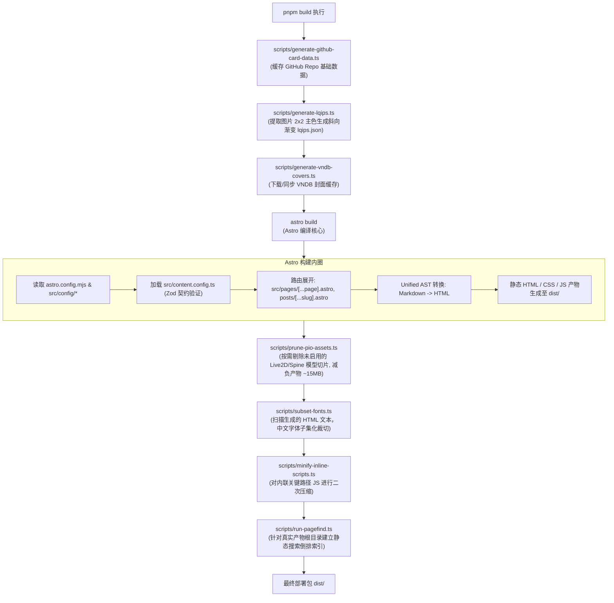
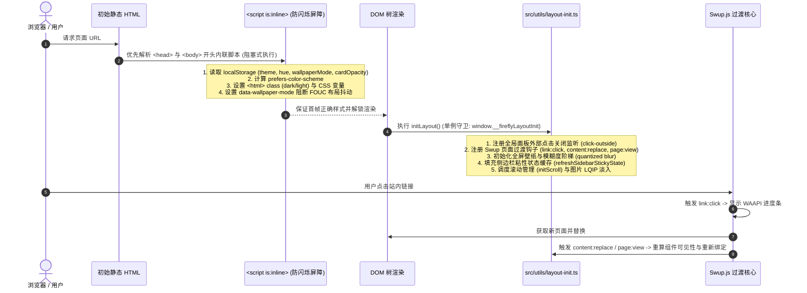
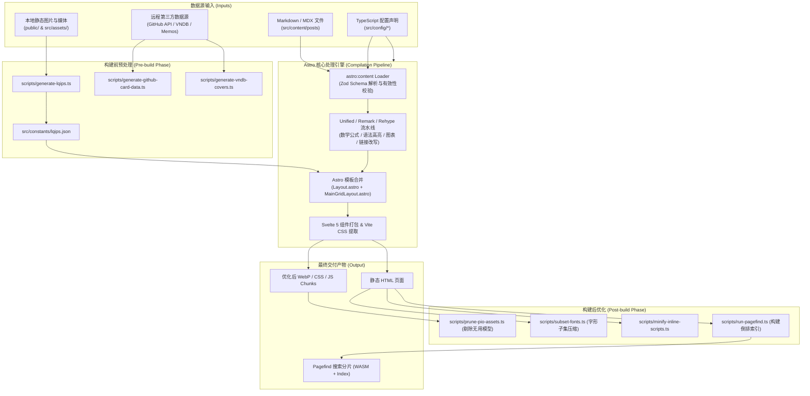
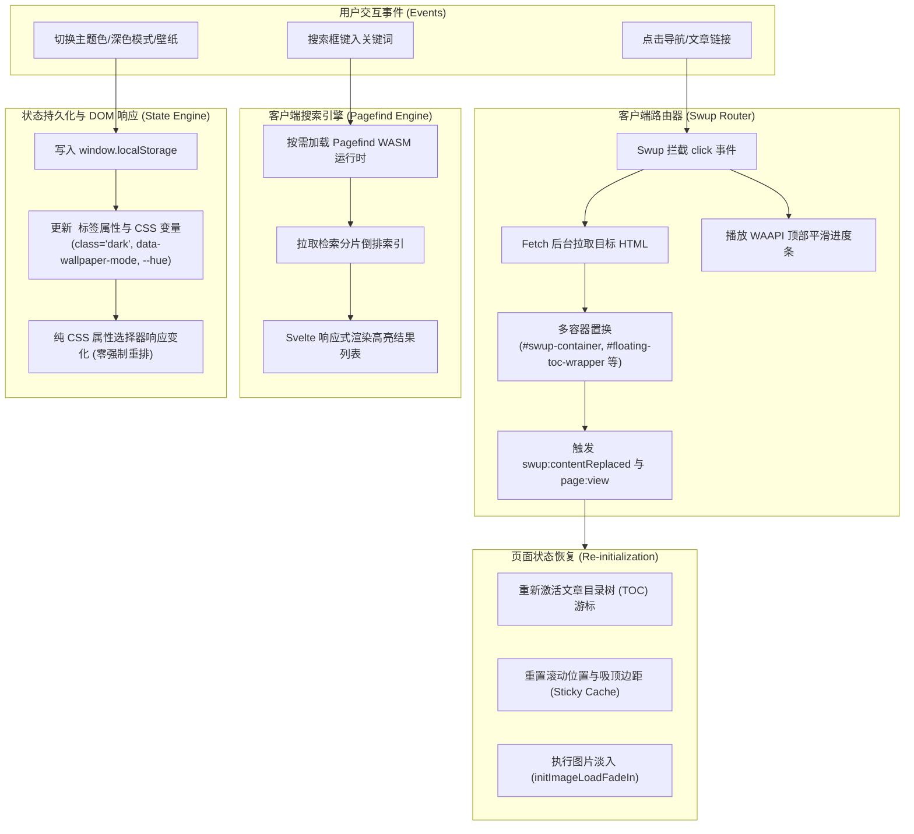

# Firefly 架构备忘录 (Architecture Memorandum)

> 本文档面向核心架构师与工程团队，系统性阐述 Firefly 静态博客主题系统的整体软件架构、双生命周期入口、模块划分及端到端数据流。

---

## 1. 核心技术栈与运行时环境

### 1.1 运行时与包管理
- **Node.js**: `>= 22.23.0`（通过 `package.json` 的 `engines` 严格约束）。
- **包管理器**: `pnpm` (`11.22.0`)，根目录配置 `preinstall: "npx only-allow pnpm"` 强制锁定。
- **模块规范**: 现代原生 ES 模块 (`"type": "module"`，`target: "ESNext"`，`moduleResolution: "bundler"`）。

### 1.2 核心框架与渲染体系
- **Astro 7 (`astro: 7.2.10`)**: 核心元框架，提供 Islands 架构、静态站点生成（SSG）、基于文件的路由及 Content Collections 内容集合管理。
- **Svelte 5 (`svelte: ^5.57.0`)**: 客户端交互微岛（Islands），采用 Svelte 5 Runes 驱动高频、动态交互部件（如全文搜索、多维设置面板、分页、媒体卡片筛选等）。
- **Tailwind CSS v4 (`@tailwindcss/vite: ^4.3.3`)**: 采用基于 Vite 插件的原子化 CSS 引擎，辅以 Stylus (`variables.styl`) 与全局主题 CSS 变量 (`--hue`, `--page-bg` 等)。
- **Swup.js (`@swup/astro: ^1.8.0`)**: 客户端无刷新页面过渡调度器，提供多容器部分替换（Multi-container partial replacement）与 SPA 级流畅体验。
- **Pagefind (`pagefind: ^1.5.2`)**: 离线静态全文索引与轻量级客户端 WASM 搜索引擎。

### 1.3 内容处理与 Markdown 扩展生态
- **Unified / Remark / Rehype**: 构建期 AST 流水线：
  - **数学公式**: `remark-math` + `rehype-katex`（内置 `mhchem` 支持化学方程式）。
  - **代码高亮**: `astro-expressive-code`，集成语言 Logo、代码折叠、行号及暗黑主题自适应。
  - **图表解析**: 自定义 `remark-mermaid` + `rehype-mermaid`，`remark-plantuml` + `rehype-plantuml`，以及 `rehype-diagram-panzoom` 矢量图缩放控制器。
  - **交互与扩展**: `rehype-callouts`、`rehype-code-group`、`remark-wiki-link`、`remark-image-grid`、GitHub 仓库卡片组件。

### 1.4 部署适配模式
- **默认/静态部署**: 输出目录 `dist`，开箱即用支持 Vercel、Netlify、GitHub Pages、EdgeOne。
- **边缘运行时**: 支持环境变量 `CF_WORKERS` 激活 `@astrojs/cloudflare` 适配器。

---

## 2. 系统入口与生命周期启动链路

静态站点生成系统具有**“编译构建期”**与**“客户端运行时”**双重生命周期。

### 2.1 编译/构建期启动链路 (Build-Time Lifecycle)

生产构建通过 `package.json` 中的复合 `build` 脚本串行编排：

### 2.2 客户端运行时初始化链路 (Client-Side Runtime Lifecycle)

当用户首次访问页面或在 Swup 拦截下切页时，初始化过程在客户端展开：

---

## 3. 核心子系统划分与职责

```mermaid
graph LR
    subgraph S1 [1. 配置与多语言中枢]
        Config["src/config/*<br/>(siteConfig, sidebarConfig, etc.)"]
        I18n["src/i18n/*<br/>(i18nKey, languages)"]
    end

    subgraph S2 [2. 内容引擎与语法流水线]
        ContentConfig["src/content.config.ts<br/>(Zod Collections)"]
        Plugins["src/plugins/*<br/>(Remark / Rehype Plugins)"]
        ContentUtils["src/utils/content-utils.ts"]
    end

    subgraph S3 [3. 混合渲染与布局层]
        Layouts["src/layouts/*<br/>(Layout, MainGridLayout)"]
        AstroComps["src/components/layout & common<br/>(Astro 静态容器)"]
        SvelteIslands["src/components/controls & pages<br/>(Svelte 5 Islands)"]
    end

    subgraph S4 [4. 客户端运行时与状态引擎]
        LayoutInit["src/utils/layout-init.ts"]
        SwupTransitions["src/utils/swup-transitions.ts"]
        SettingUtils["src/utils/setting-utils.ts"]
        ScrollUtils["src/utils/scroll-utils.ts"]
    end

    subgraph S5 [5. 构建优化与资产引擎]
        LQIP["scripts/generate-lqips.ts"]
        SubsetFonts["scripts/subset-fonts.ts"]
        PrunePio["scripts/prune-pio-assets.ts"]
        Pagefind["scripts/run-pagefind.ts"]
    end

    S1 --> S2
    S1 --> S3
    S1 --> S4
    S1 --> S5
    S2 --> S3
    S3 --> S4
    S5 -.->|离线处理产物| S3
```

### 3.1 配置与多语言驱动中枢 (Configuration & i18n Core)
- **位置**: `src/config/*`, `src/types/*`, `src/i18n/*`
- **职责**:
  - 全站单一事实来源（SSOT）。将站点设置、个人画像、布局形态、背景壁纸、评论系统、第三方媒体集成的配置解耦为独立声明式模块。
  - 通过 `src/config/index.ts` 集中 Barrel 导出，提供完全强类型的类型契约。
  - `src/i18n/` 提供基于 `I18nKey` 的多语言字典和回退映射，支持运行时与构建期文本无缝本地化。

### 3.2 内容引擎与 Markdown 处理流水线 (Content Engine & Pipeline)
- **位置**: `src/content.config.ts`, `src/content/*`, `src/plugins/*`, `src/utils/content-utils.ts`
- **职责**:
  - 利用 Astro 7 最新 Content Loader API (`glob`)，定义 `posts`（博客文章）、`dynamic`（轻动态/说说）、`spec`（特定单页）的 Zod 数据校验模式。
  - 编排统一的 Remark/Rehype 插件流：处理公式渲染、代码块行号与折叠、Mermaid/PlantUML 图表、文章字数与预计阅读时间（Frontmatter 注入）、WikiLink 双链及外链安全策略。
  - `content-utils.ts` 提供文章置顶算法、按日期排序、上下文上一篇/下一篇计算、系列文章聚合索引及分类标签统计。

### 3.3 混合岛屿渲染与布局层 (Hybrid Islands UI & Adaptive Layout)
- **位置**: `src/layouts/*`, `src/components/*`
- **职责**:
  - **宏观布局（Astro Shell）**: `Layout.astro` 负责 `<head>` 元信息、SEO 结构化数据（JSON-LD Schema）、关键防闪烁脚本注入；`MainGridLayout.astro` 动态根据配置排布 1/2/3 列自适应响应式栅格，注入壁纸、导航栏、侧边栏及页脚。
  - **微观交互（Svelte 5 Islands）**: 在静态 HTML 骨架中，仅对高动态、状态敏感的组件采用 Svelte 5 进行水合（如 `Search.svelte` 搜索模态框、`DisplaySettings.svelte` 主题滑块与壁纸切换、`FilterControls.svelte` 客户端动态筛选）。

### 3.4 客户端运行时与状态过渡引擎 (Client Runtime & Transition Engine)
- **位置**: `src/utils/layout-init.ts`, `src/utils/swup-transitions.ts`, `src/utils/setting-utils.ts`, `src/utils/scroll-utils.ts`
- **职责**:
  - 维护 SPA 级跳转：管理 Swup 容器（`#swup-container`、`#banner-overlay-container`、`#left-sidebar-dynamic` 等 6 个容器），处理切页时的滚动复位、目录树（TOC）更新与 WAAPI 平滑进度条。
  - 维护客户端偏好设置持久化：基于 `localStorage` 保持色相、暗色模式、卡片透明度、壁纸模式；通过变更 DOM 属性选择器实现全局无回流主题热替换。
  - 滚动性能与渲染性能守卫：针对移动端高频滚动，实施严格的 rAF 节流、全屏壁纸模糊度阶梯量化（Quantized blur in 2px steps）、侧边栏粘性布局状态（Sticky Cache）解耦计算，杜绝滚动过程中的强制同步布局（Forced Reflow）。

### 3.5 离线优化与静态检索体系 (Offline Build Optimization & Asset Pipeline)
- **位置**: `scripts/*`, `pagefind.yml`
- **职责**:
  - **图片预处理**: `generate-lqips.ts` 借助 Sharp 将图片微缩至 2x2 并提取主色调，编码为十六进制斜向渐变，写入 `lqips.json` 随源码版本提交。
  - **资产动态瘦身**: `prune-pio-assets.ts` 在 Astro 打包后介入，若用户未启用 Live2D 或 Spine 看板娘，物理移除产物内无用静态模型，单站瘦身达 15MB。
  - **中文字体子集化**: `subset-fonts.ts` 遍历整站生成的最终 HTML 内容，抓取实际出现字形，借助 `subset-font` 压缩打包字体文件。
  - **离线倒排索引**: `run-pagefind.ts` 在构建收尾阶段解析产物目录，生成极低体积的静态分片索引供客户端随时检索。

---

## 4. 端到端数据流架构 (End-to-End Data Flow)

### 4.1 数据流 1：构建期内容编译与产物输出流 (SSG Flow)

### 4.2 数据流 2：客户端请求与交互事件流 (Runtime Interaction Flow)

---

## 5. 架构关键设计原则与工程考量

1. **零运行时闪烁 (FOUC Prevention)**:
   主题颜色、深浅模式、全屏壁纸及卡片透明度等视觉参数完全解耦于 UI 组件生命周期，在 `<head>` 最前端通过阻塞式纯 JS 脚本在首帧绘制前写入 `<html>` 属性，样式通过原生 CSS 属性选择器接管，彻底解决现代前端应用中常见的白屏或样式跳动。
2. **极致高频滚动性能 (Scroll Performance Guard)**:
   全屏壁纸模糊度阶梯通过 2px 步长离散化缓存；侧边栏高度与可见性仅在切页或窗口改变时单次计算并写入缓存，滚动事件处理器全量通过 `requestAnimationFrame` 节流且只读缓存，严禁在滚动帧内调用 `offsetHeight` / `getComputedStyle`。
3. **岛屿架构与渐进式脱水 (Islands Architecture)**:
   全站绝大部分内容、侧边栏小部件、页面骨架均为 0kb JS 的纯静态 Astro 组件。仅有搜索、个性化设置等核心交互微部件通过 Svelte 5 客户端微岛按需水合，极大压缩客户端首屏包体积。
4. **编译时构建优化与全站离线闭环**:
   搜索能力不依赖任何外部后端 API，在 CI/CD 构建阶段使用 Rust 原生驱动的 Pagefind 直接生成倒排索引；图片 LQIP 与字体子集化全部编译期固化，确保部署后的站点具备极高的抵御高并发能力与零维护成本。
